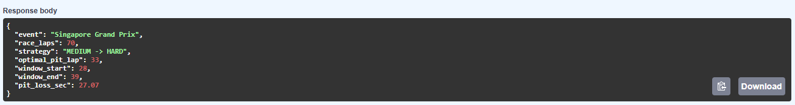
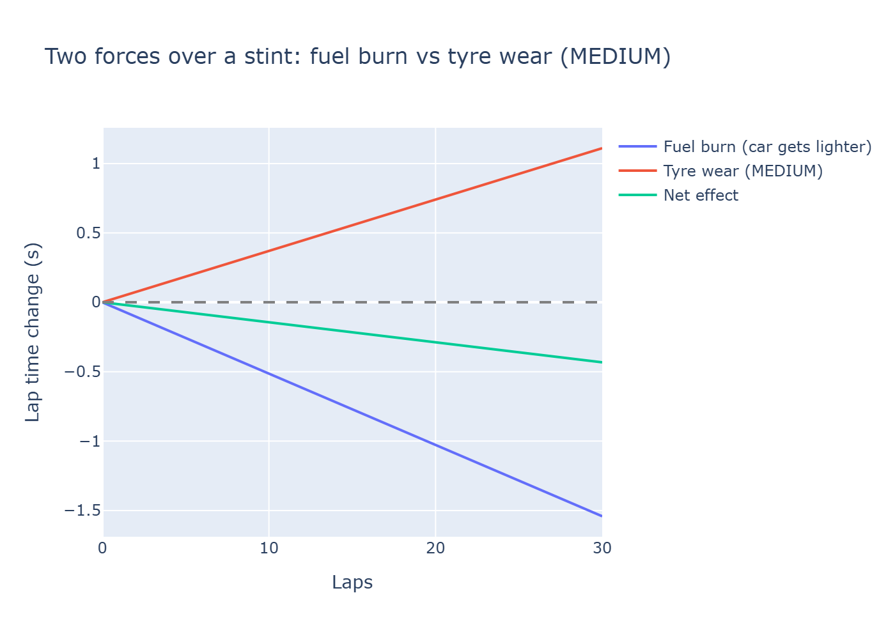
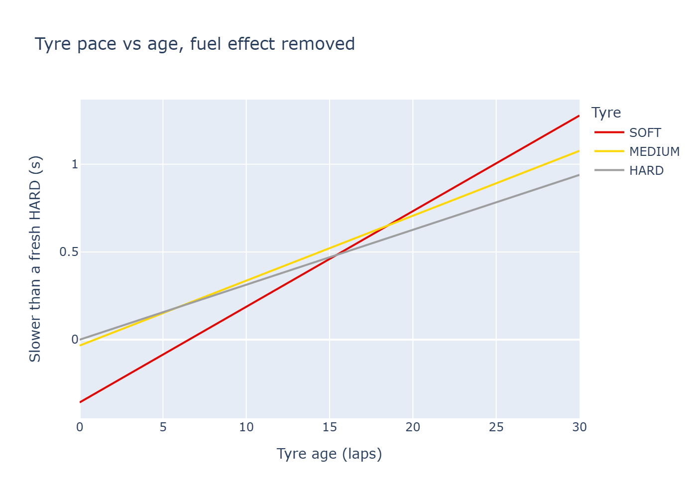
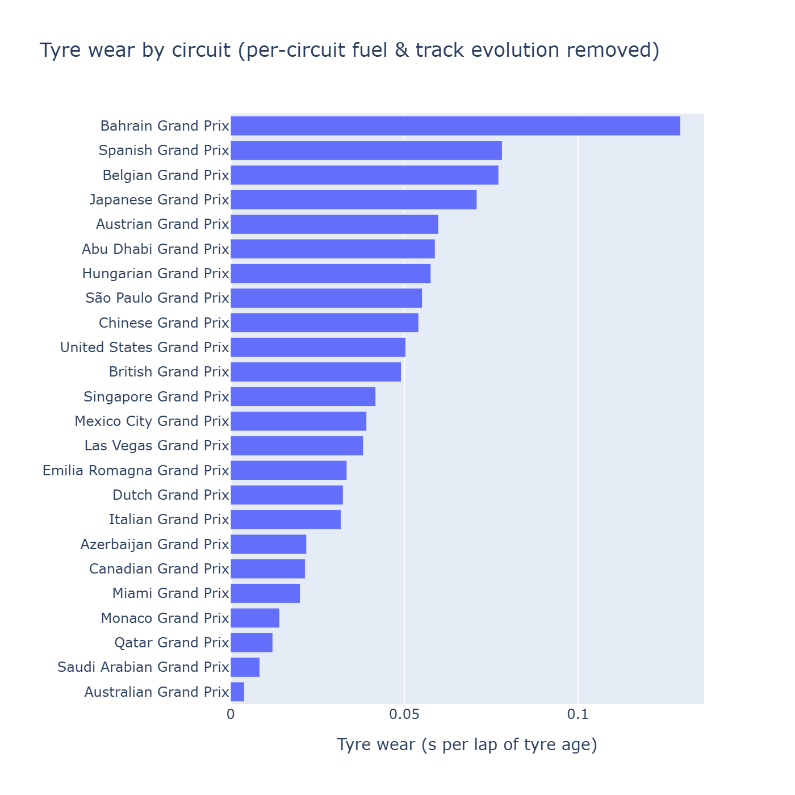
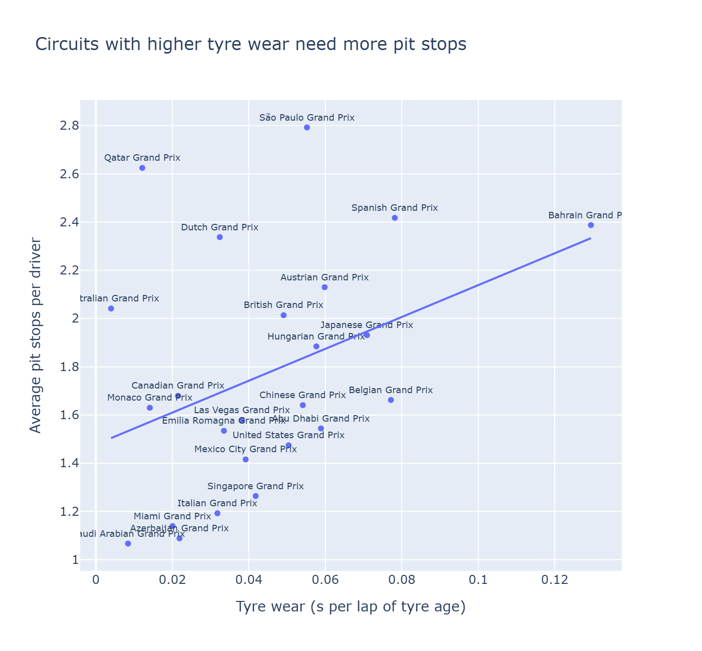
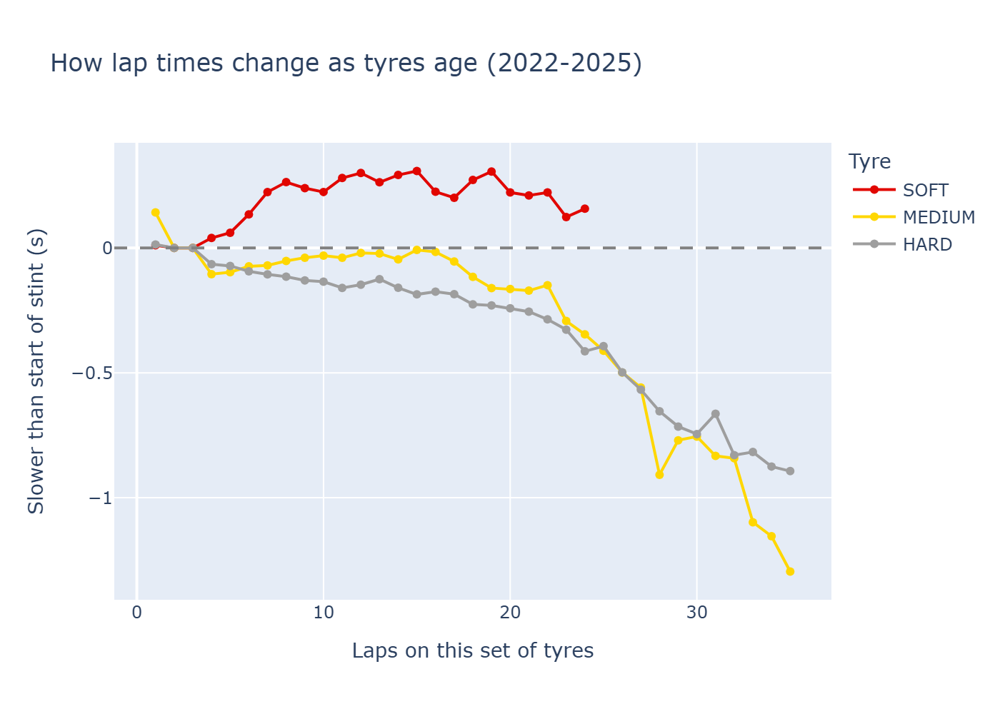
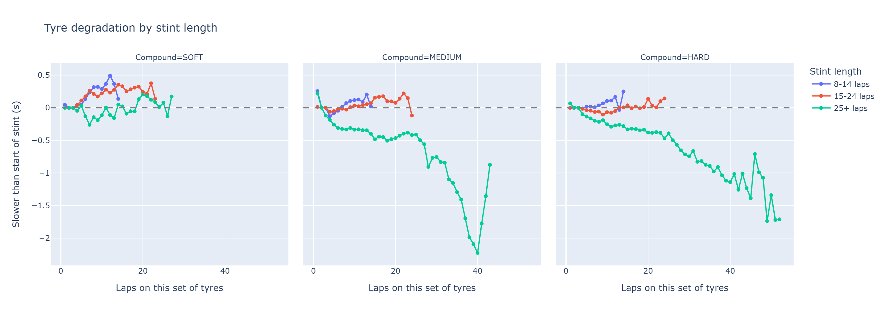
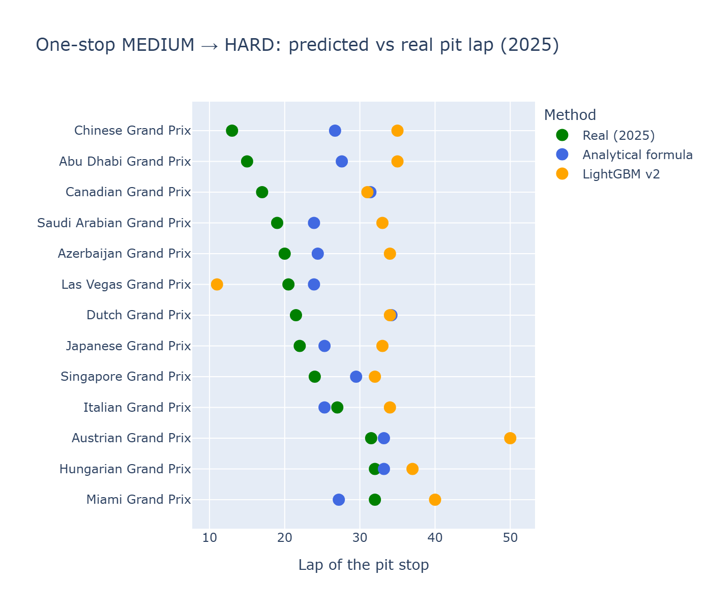
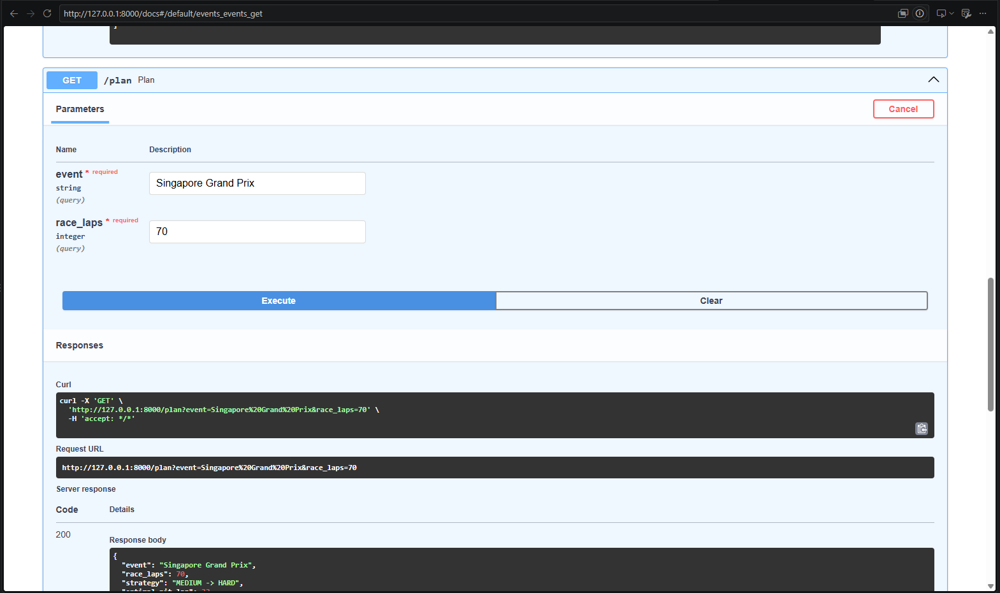

# F1 Pit-Stop Strategy: when should a driver pit?

[](https://github.com/Vlvasile/f1-pit-strategy/actions/workflows/ci.yml)


An end-to-end ML project on Formula 1 timing data, from raw lap data to a tested, containerised API. It answers one question: **in a one-stop race (MEDIUM → HARD tyres), on which lap should a driver pit to lose the least time?**

## TL;DR

- **Data:** 92 races (2022–2025) from the FastF1 API. After cleaning: 78,233 laps.
- **Modelling:** LightGBM lap-time models tracked in MLflow, compared against a simple physics-based formula fitted with fixed-effects regression.
- **Result:** the simple formula beat the ML model. On 2025 races (held out, never used for fitting), it predicts the real pit lap with a **median error of 3.8 laps**. The best LightGBM simulator was off by 12.6 laps on average.
- **Engineering:** the formula is served by a **FastAPI** service, packaged with **Docker**, covered by **13 pytest tests**, and checked by **GitHub Actions** CI on every push.

**Stack:** Python · pandas · NumPy · scikit-learn · LightGBM · MLflow · Plotly · FastAPI · pytest · Docker · GitHub Actions



---

## Contents

1. [The problem](#1-the-problem)
2. [Data pipeline](#2-data-pipeline)
3. [What the data shows](#3-what-the-data-shows)
4. [Lap-time models](#4-lap-time-models)
5. [Pit strategy: ML vs a simple formula](#5-pit-strategy-ml-vs-a-simple-formula)
6. [Strategy API](#6-strategy-api)
7. [Run it yourself](#7-run-it-yourself)
8. [Project structure](#8-project-structure)
9. [Limitations and next steps](#9-limitations-and-next-steps)

---

## 1. The problem

Two effects compete over a race:

- **Tyre wear.** Every lap on the same set of tyres is a little slower than the last.
- **Pit-stop cost.** Changing tyres costs 19–30 seconds in the pit lane.

Pit too early, and the second set of tyres has to last a very long time. Pit too late, and you spend many laps on worn tyres. Somewhere in between, the total time lost is smallest. The goal is to find that lap from data.

## 2. Data pipeline

| Step | Notebook / module | Output |
|---|---|---|
| Explore one race (Monza 2024) | `01_load_data.ipynb` | cleaning rules |
| Download all races 2022–2025 | `02_ingest.ipynb`, `src/ingest.py` | one parquet file per race; resumes after the 500 calls/hour API limit |
| Clean and validate | `03_clean.ipynb`, `src/clean.py` | `laps_model.parquet` |

Cleaning removes lap 1, in/out laps, laps under yellow flag or safety car, inaccurate and deleted laps, and wet-tyre laps. Laps more than 5% slower than their stint median (traffic, mistakes) are also removed.

**83,684 laps → 78,233 clean dry laps.** Checks run along the way: no missing rounds, no duplicate laps, no missing key fields.

## 3. What the data shows

`04_eda.ipynb` covers four questions.

**Q1. How fast does each tyre degrade?** Looking at raw lap times, tyres barely seem to degrade, because the car also gets faster as it burns fuel. A second effect is survivorship bias: long stints happen on tyres that are holding up well, so they look faster than average.

**Q2. Separating fuel from tyre wear.** A regression with race × driver fixed effects separates the two:

| Effect | Seconds per lap |
|---|---|
| Fuel burn + track evolution | −0.051 |
| SOFT wear | +0.055 |
| MEDIUM wear | +0.037 |
| HARD wear | +0.031 |

A fresh SOFT is about 0.36 s faster than a fresh HARD, but after ~15 laps it becomes the slower tyre.

<p align="center">
  
  
</p>

**Q3. Wear by circuit.** Bahrain wears tyres the most (0.129 s/lap). Australia wears them the least (0.004 s/lap).

**Q4. Wear and strategy.** Circuits with higher wear see more pit stops, from about 1.1 to 2.4 stops per driver on average.

<details>
<summary>More charts</summary>






</details>

## 4. Lap-time models

`05_model.ipynb`. The target is each lap's time relative to the driver's median for that race. **Train: 2022–2024. Test: 2025.**

| Model | Train MAE (s) | Test MAE (s) |
|---|---|---|
| Naive baseline (predict 0) | – | 0.796 |
| Linear regression | 0.587 | 0.594 |
| LightGBM, default parameters | 0.396 | 0.603 (overfit) |
| LightGBM, regularised + early stopping | 0.526 | 0.554 |
| LightGBM, monotone constraints | 0.535 | **0.553** |

All runs are logged to **MLflow** (SQLite backend), and the final models are in the MLflow Model Registry (`lap-time-lgbm` v1 and v2).

## 5. Pit strategy: ML vs a simple formula

**Approach 1: ML simulator.** For every possible pit lap, LightGBM predicts every lap of the race. The simulator adds the pit-stop loss and picks the lap with the lowest total.

**Approach 2: analytical formula.** If wear grows linearly with tyre age, the total time lost is a parabola in the pit lap *p*:

$$T(p) = \frac{w_M\,p^2}{2} + \frac{w_H\,(N-p)^2}{2} - g\,p
\quad\Rightarrow\quad
p^* = \frac{w_H\,N + g}{w_M + w_H}$$

Here *N* is the race length in laps. *w_M* = 0.0361 and *w_H* = 0.0314 are MEDIUM and HARD wear in seconds per lap, and *g* = 0.0451 is the pace gap between fresh MEDIUM and fresh HARD tyres. All three were **fitted on 2022–2024 only**, so the 2025 evaluation is out-of-sample.

**Evaluation against real 2025 one-stop MEDIUM → HARD races:**

| Method | Mean error vs real pit lap |
|---|---|
| LightGBM v1 simulator | 17.3 laps |
| LightGBM v2 (monotone) simulator | 12.6 laps |
| **Analytical formula** | **6.5 laps** |

Restricting to green-flag stops (12 circuits), the formula has a **mean error of 5.3 laps and a median of 3.8 laps**, and 8 of 12 circuits are within 5 laps. On average it pits about 4 laps later than the teams. That fits the *undercut*: teams stop early to pass rivals on fresh tyres, and the formula knows nothing about rivals. Fitting the formula separately per circuit made it worse (mean error 6.6 laps): there is too little data per track.



**Why ML lost.** The LightGBM model predicts single laps well, but it learned from races where teams made real decisions. For example, tyres in long stints were usually tyres that were holding up well. When the simulator asks "what if we stayed out 15 more laps?", the model extrapolates from those biased examples. The formula has the right structure built in, so it extrapolates sensibly.

## 6. Strategy API

The formula is in `src/strategy.py` (pure Python with pandas, no ML dependencies) and is served by FastAPI:

| Endpoint | Returns |
|---|---|
| `GET /health` | `{"status": "ok"}` |
| `GET /events` | the 24 supported Grand Prix names |
| `GET /plan?event=...&race_laps=...` | optimal pit lap, ±1 s pit window, pit-lane time loss |

```bash
curl "http://127.0.0.1:8000/plan?event=Italian%20Grand%20Prix&race_laps=53"
```

```json
{
  "event": "Italian Grand Prix",
  "race_laps": 53,
  "strategy": "MEDIUM -> HARD",
  "optimal_pit_lap": 25,
  "window_start": 20,
  "window_end": 31,
  "pit_loss_sec": 26.06
}
```

Error handling: an unknown circuit returns `404`, and a race too short for two 8-lap stints returns `422`.

Interactive docs (Swagger UI) are available at `/docs`:

<p align="center">
  
</p>

**Quality checks**

- **13 pytest tests**: unit tests for the strategy functions, plus API tests with FastAPI's `TestClient`.
- **GitHub Actions** on every push: install dependencies → run the tests → build the Docker image → start the container and smoke-test `/health`.
- The Docker image installs only `fastapi`, `uvicorn` and `pandas` (`requirements-api.txt`), not the full research stack.

## 7. Run it yourself

**API with Docker** (no Python setup needed):

```bash
git clone https://github.com/Vlvasile/f1-pit-strategy.git
cd f1-pit-strategy
docker build -t f1-pit-strategy .
docker run -p 8000:8000 f1-pit-strategy
```

Then open http://127.0.0.1:8000/docs.

**Tests:**

```bash
pip install -r requirements-api.txt pytest httpx2
python -m pytest
```

**Full research pipeline** (notebooks 01–06):

```bash
conda create -n f1 python=3.11
conda activate f1
pip install -r requirements.txt
```

Run the notebooks in order. `02_ingest` downloads about 92 races from the FastF1 API, which is rate-limited, so the first run takes a few hours. It resumes where it stopped.

## 8. Project structure

```
├── notebooks/
│   ├── 01_load_data.ipynb     # explore one race, define cleaning rules
│   ├── 02_ingest.ipynb        # download 2022–2025 seasons
│   ├── 03_clean.ipynb         # validation and outlier filtering
│   ├── 04_eda.ipynb           # tyre wear, fuel effect, circuits, strategy
│   ├── 05_model.ipynb         # LightGBM + MLflow, pit loss, strategy evaluation
│   └── 06_api_prep.ipynb      # export lookup table for the API, manual checks
├── src/
│   ├── ingest.py              # FastF1 download with rate-limit resume
│   ├── clean.py               # lap cleaning rules
│   ├── strategy.py            # pit-lap formula, pit window, pit-loss lookup
│   └── data/pit_loss.csv      # pit-lane time loss per circuit
├── api/main.py                # FastAPI service
├── tests/                     # pytest: strategy + API
├── .github/workflows/ci.yml   # CI: tests, Docker build, smoke test
├── Dockerfile
├── requirements.txt           # full research environment
└── requirements-api.txt       # minimal runtime for the API
```

## 9. Limitations and next steps

**Limitations**

- Only one-stop MEDIUM → HARD strategies are covered.
- Safety cars, rivals and traffic are not modelled (this explains the ~4-lap bias against the undercut).
- The global formula uses the same wear rates for every circuit, so the pit window is about ±5 laps everywhere.
- The evaluation set is small (12–13 circuits from one season).
- `race_laps` is taken from the user and not checked against the real race length.

**Next steps**

- Two-stop strategies and SOFT tyres.
- A Safety Car probability adjustment and an undercut term.
- Hierarchical (partially pooled) wear per circuit, to fix the data-per-track problem.
- Deploy the API to a public host.

---

Data: [FastF1](https://github.com/theOehrly/Fast-F1). This is an independent learning project, not affiliated with Formula 1.
